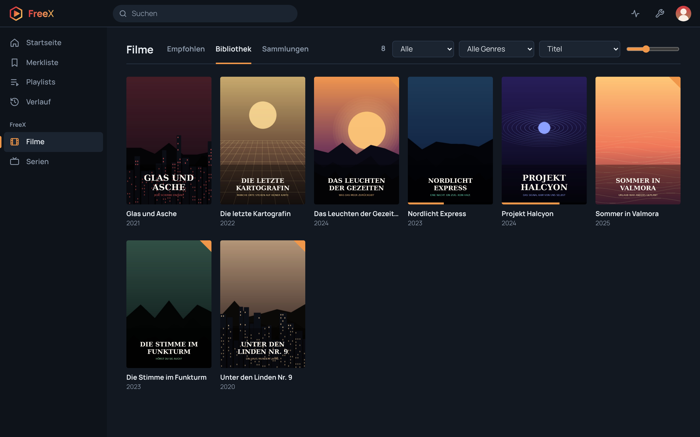
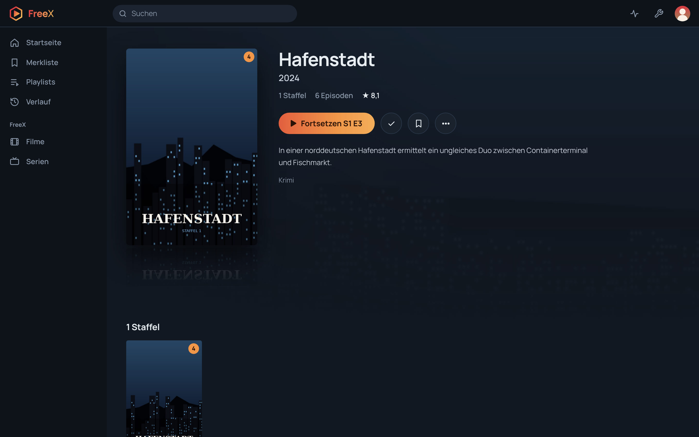

<p align="center">
  
</p>

<h1 align="center">FreeX Media Server</h1>

<p align="center">
  <strong>Your Media. Your Server. Your Freedom.</strong>
</p>

<p align="center">
  <a href="LICENSE"></a>
  
  
  
</p>

FreeX Media Server is a self-hosted, open-source media server for your movies and TV shows. It organizes your
folders into a library with artwork and metadata, remembers where every user stopped, and streams to any modern
browser, converting on the fly when a device cannot play a file. No account with a third party, no cloud, no
telemetry: your media stays on your hardware.

It is the core of **FreeX**, a family of apps around one server. The web client **FreeX Web** is built in;
native apps for iOS, Android and TV are planned and will use the same API.

<p align="center">
  
  
</p>
<p align="center"><sub>The titles and artwork in the screenshots are made up for the demo.</sub></p>

## Highlights

- **Beautiful library** – home screen with *Continue watching*, *Up next* and *Recently added*, poster grids,
  collections, playlists, watchlist and search
- **Plays everything** – direct play when the browser can decode the file, otherwise on-the-fly conversion to HLS
  with ffmpeg, with optional hardware acceleration (NVENC, Quick Sync, VAAPI)
- **Rich metadata** – from [TMDB](https://www.themoviedb.org/) with your own free key, or fully offline from Kodi
  `.nfo` files and local artwork
- **Skip intro and credits** – detected automatically from the audio, with a *Next episode* countdown
- **Chromecast** – cast from Chrome, with the browser as remote control
- **Watch Together** – watch in sync with other users of your server
- **Multi-user** – personal watch state, history, profile pictures and audio/subtitle language preferences
- **Secure by default** – two-factor sign-in, brute-force protection, per-device sessions, strict security headers
- **Easy to run** – one self-contained jar, or a Debian package with a hardened systemd service
- **Managed in the browser** – libraries, users and server settings, plus a live activity view for admins

## The FreeX family

| Product | Description | Status |
|---|---|---|
| **FreeX Media Server** | The core: libraries, users, streaming, conversion and the API | this repository |
| **FreeX Web** | Web interface and browser client, served by the server | included (`src/main/resources/web`) |
| **FreeX iOS** | Native iPhone and iPad app | planned |
| **FreeX Android** | App for Android smartphones and tablets | planned |
| **FreeX TV** | Smart TV and streaming device apps | later |

Server and web client are versioned separately: the server uses the Maven version in `pom.xml` (e.g. `0.9.0`),
FreeX Web the version in [`src/main/resources/web/version.json`](src/main/resources/web/version.json)
(e.g. `1.0.0.0`). Both are shown under *Settings → Über FreeX*.

## Quick start

### Debian / Ubuntu

Build the package (or take it from your CI) and install it; ffmpeg and Java come in as dependencies:

```bash
git clone https://github.com/LinzN/freex-media-server.git
cd freex-media-server
mvn clean package
sudo apt install ./target/freex-media-server_*_all.deb
```

Open `http://<your-server>:32500/`, create the admin account and add your movie and TV show folders. The service
runs as the user `freex`, which needs read access to your media, for example
`sudo setfacl -R -m u:freex:rX /srv/media`.

### Any system with Java 21

```bash
mvn clean package
LANG=C.UTF-8 java -jar target/freex-media-server.jar
```

A commented `config.yml` is created on the first start. Install `ffmpeg` for media info, preview images and
conversion.

See [Installation](docs/installation.md) for details, paths, updates and running as a service.

## Documentation

| | |
|---|---|
| [Installation](docs/installation.md) | Debian package, manual setup, systemd, file locations, backups |
| [Configuration](docs/configuration.md) | All settings, the settings page, HTTPS and reverse proxies |
| [Organizing your media](docs/media-library.md) | Folder and file naming, local artwork, `.nfo` files, TMDB |
| [Playback](docs/playback.md) | Direct play and conversion, hardware acceleration, subtitles, skip intro, Watch Together, Chromecast |
| [Security](docs/security.md) | Sign-in, two-factor authentication, sessions and how the server is hardened |
| [API](docs/api.md) | The JSON API used by FreeX Web and the upcoming apps |
| [Development](docs/development.md) | Project structure, building, versioning and contributing |

## Requirements

- Java 21 or newer
- `ffmpeg` and `ffprobe` (recommended; without them only files the browser can play directly work)
- A modern browser: Chrome, Edge, Firefox or Safari, on desktop or mobile

## Roadmap

FreeX Media Server is under active development and has not reached 1.0 yet. Planned next:

- Native apps: **FreeX iOS**, **FreeX Android** and **FreeX TV**
- Public, versioned API documentation for third-party clients
- Music and photo libraries
- Parental controls with age ratings per user
- Downloads for offline playback in the apps

## Contributing

Bug reports, ideas and pull requests are welcome. Please open an issue first for larger changes so we can agree on
the approach. See [Development](docs/development.md) for how to build and test the server. Please report security
problems privately to niklas.linz@mirranet.de instead of opening a public issue.

## License

FreeX Media Server is free software under the [GNU Lesser General Public License v3.0](LICENSE).

It bundles the font Manrope (SIL Open Font License), [hls.js](https://github.com/video-dev/hls.js) (Apache 2.0) and
[qrcode-generator](https://github.com/kazuhikoarase/qrcode-generator) (MIT); their licenses are in
`src/main/resources/web`. Metadata can be loaded from TMDB: this product uses the TMDB API but is not endorsed or
certified by TMDB.
